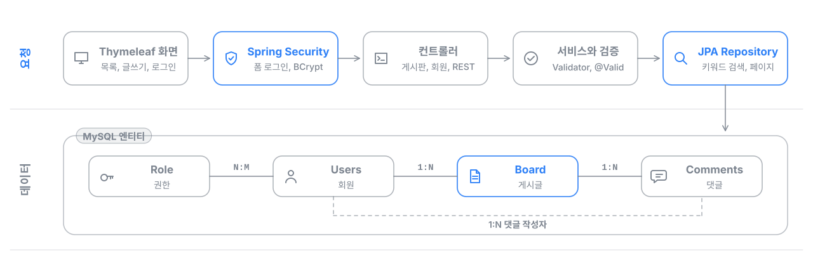

# Spring Boot 커뮤니티 게시판

Spring Boot와 JPA로 만든 회원제 게시판입니다. 회원가입과 로그인, 게시글 작성, 수정, 삭제, 키워드 검색과 페이지 이동을 구현했습니다. 2023년 7월에 2주 동안 진행한 개인 프로젝트입니다.



## 주요 기능

- Spring Security 폼 로그인, BCrypt 비밀번호 암호화, 회원가입
- 게시글 작성, 수정, 삭제 (작성자는 로그인한 회원으로 기록)
- 제목과 내용 키워드 검색, 10건 단위 페이지네이션
- Bean Validation과 커스텀 Validator로 입력값 검증
- 게시글 조회, 등록 REST API (`/api/board/...`)
- 회원, 권한, 게시글, 댓글 엔티티 연관관계 설계 (JPA)

## 기술 스택

| 영역 | 기술 |
| --- | --- |
| 백엔드 | Java 17, Spring Boot 3.1, Spring Security, Spring Data JPA, Lombok |
| 화면 | Thymeleaf, Bootstrap 5 |
| DB와 빌드 | MySQL, Gradle |

## 실행 방법

MySQL에 빈 데이터베이스를 만들고 접속 정보를 환경 변수로 지정한 뒤 실행합니다. 테이블은 처음 실행할 때 JPA가 만듭니다.

```bash
export DB_URL="jdbc:mysql://localhost:3306/board?serverTimezone=UTC&characterEncoding=UTF-8"
export DB_USERNAME=board
export DB_PASSWORD=<비밀번호>
./gradlew bootRun
```

회원가입 전에 기본 권한을 한 번 넣어 둡니다.

```sql
INSERT INTO role (name) VALUES ('ROLE_USER');
```

`http://localhost:8080`에서 회원가입 후 로그인하면 게시판을 사용할 수 있습니다.

## 디렉터리 구조

```text
src/main/java/com/example/crud/
├── Config/        # Spring Security 설정
├── controller/    # 게시판, 회원, REST API 컨트롤러
├── service/       # 게시글 저장, 회원가입
├── repository/    # JPA Repository (검색, 페이지)
├── model/         # Users, Role, Board, Comments 엔티티
├── Dto/
└── vailidator/    # 게시글 입력 검증
src/main/resources/templates/   # Thymeleaf 화면
```
